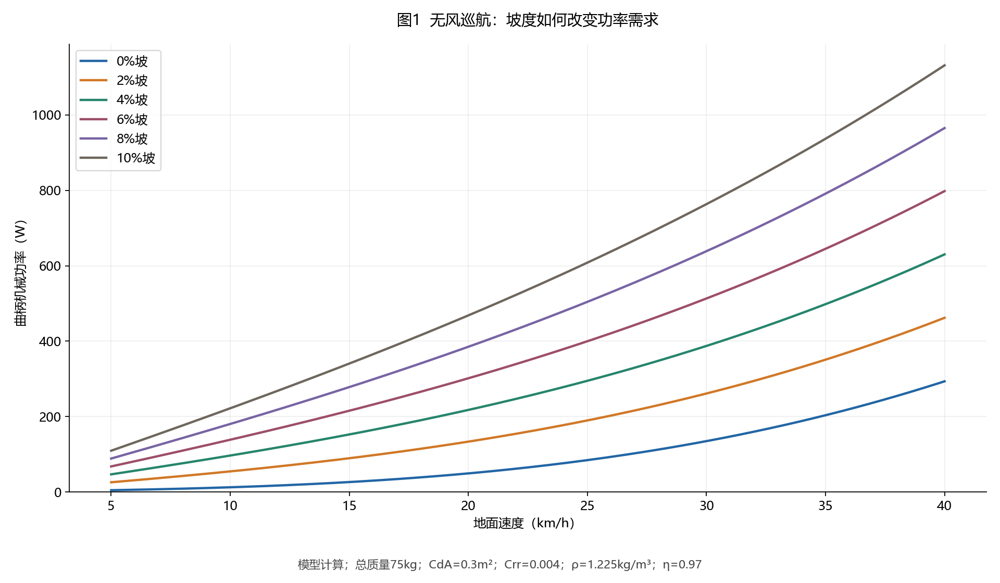
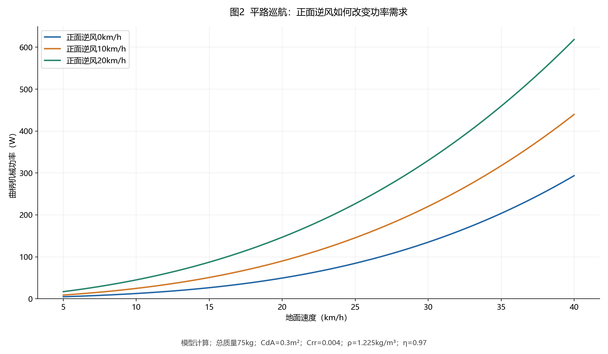
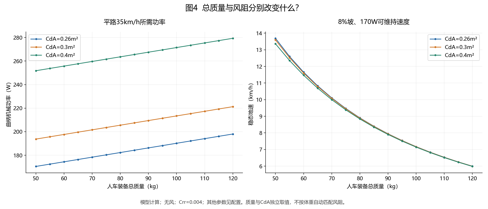
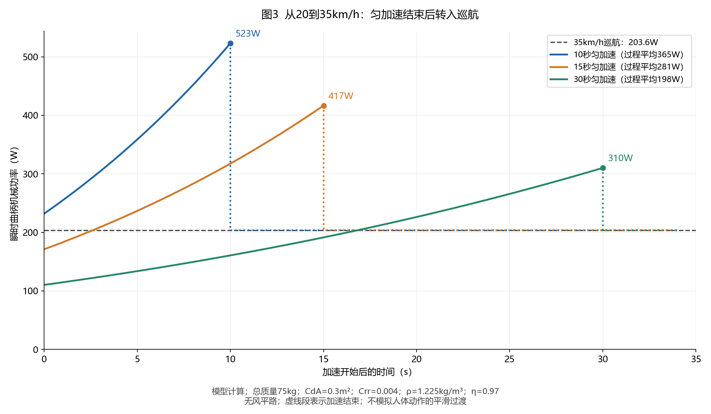
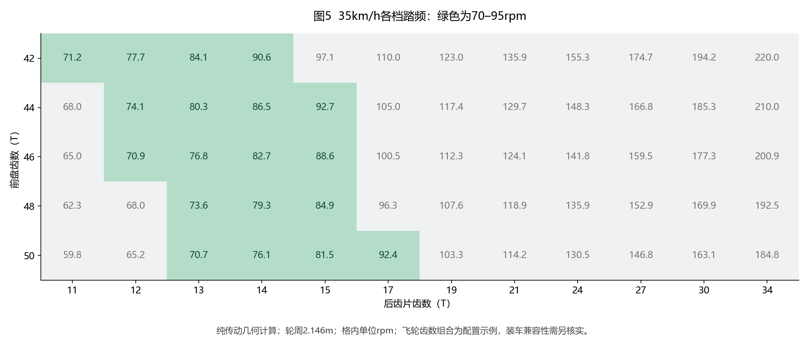

# 骑行传动、功率与阻力的数学模型：理论综述与可复算分析

*Mathematical Models of Cycling Transmission, Power and Resistance: A Theoretical Review with Reproducible Analyses*

## 摘要

骑行速度由道路与环境造成的机械功率需求、传动系统的转速及扭矩关系，以及骑手可持续输出共同决定。本文以已有道路骑行功率模型为基础，统一讨论齿比、踏频、曲柄与轮端功率、坡度、空气阻力、滚动阻力和加速惯性之间的数学关系；比较参数辨识、传动效率和个体踏频研究的建模目标与适用边界。在一维道路假设下，对巡航、匀加速与恒功率加速进行可复算分析，并以不同总质量和阻力情景，以及单前盘、双前盘的档位集合给出数值示例。基础物理关系采用已有理论，复合式与数表为本文整理和复算；数值校验与实测验证分别讨论。

关键词：骑行动力学；传动比；机械功率；踏频；空气阻力；滚动阻力；参数辨识

## 研究范围与文献脉络

本文是一篇叙述性理论综述与可复算分析，目标是把分散在骑行动力学、传动效率和生理输出研究中的关系放在一致的符号与单位体系下，解释它们如何组合、何时需要更复杂的模型。文献按建模问题组织，并沿代表性论文的参考文献扩展；不将这次范围性检索称为穷尽文献的系统综述，也不把已发表的基本关系主张为首次提出。

Olds等的道路表现模型[18]与Martin等的实测验证[1]构成机械功率需求的主要基础。Bos等[19]已将坡度、功率、踏频、齿比与垂直爬升速度联立；Danek等[20]把功率计和GPS测量用于阻力参数估计。Reed等[21]、Dunst等[22]及Dusling[24]分别从个体踏频、疲劳与加速过程研究骑手输出和齿比的耦合。传动损失模型[12][23]则解释了为什么相同几何齿比的不同零件组合也可能有不同实际表现。

| 模型分支 | 代表文献 | 主要问题 | 本文的整理与应用 |
|---|---|---|---|
| 道路功率需求与验证 | Olds等1995[18]；Martin等1998[1] | 阻力、势能和动能如何对应机械功率 | 统一符号、推导简化式并复算；不继承其他实验的预测精度 |
| 气动参数与测试方法 | Grappe等1997[13]；Malizia与Blocken2020[25] | 姿态、装备及测试条件怎样改变气动结果 | 解释CdA与Cd的区别、参考值来源及测试可比性 |
| 爬坡、踏频与齿比 | Bos等2020/2021[19] | 给定功率时坡度、踏频、齿比与爬升速度的关系 | 作为传动几何与道路需求联立的已有先例 |
| 参数辨识与不确定性 | Danek等2021[20] | 如何从功率和速度测量估计阻力参数 | 讨论可辨识性、有效参数与独立验证；本文情景网格没有概率含义 |
| 个体生理与动态输出 | Reed等2016[21]；Dunst等2023[22]；Dusling2026[24] | 踏频、疲劳和加速如何影响可输出功率 | 对比外部需求与人体供给；本文数值程序尚未拟合个体生理模型 |
| 传动效率与齿片尺寸 | Dowd等2025[12]；Barnaby等2020[23] | 扭矩、转速与齿片尺寸怎样影响损失 | 解释固定η的适用边界；[23]为会议短摘要，[24]目前仅核对出版商摘要 |

本文将三个相互关联但不同的问题分开：**道路需要多少功率、传动将它映射为什么踏频和扭矩、骑手能否持续提供该输出。**单盘、双盘、多前盘或内变速可在相同运动学定义下描述；具体装置的可用档位、效率和换挡过程需另建约束。本文提供的一维数值程序计算前两类关系，生理供给、侧风、下坡制动和换挡瞬态作为扩展讨论。

**阅读顺序：**第二、三、五节给出传动、阻力和加速推导；第一、八节说明参数依据与不确定性；第四、六、七节提供质量分级、不同齿数组合与传动范围算例；计算附录给出积分过程和复算方法。

## 一、计算条件、参数依据与适用边界

本文讨论单人、无跟骑、无刹车、沿直线道路骑行；坡度与正面逆风在所考察路段内不变。只计算平路和上坡，不外推到下坡制动、强顺风或侧风。风速是沿道路反向的分量，不是气象站风力等级。

### 1. 质量只输入一个人车装备总质量

总质量M包含骑手、自行车、衣物、水、工具和行李，车轮实际质量也已经包含在内。稳态重力和滚阻计算只需要这个总量，不再拆分车重与人重。本版取消“W/kg骑手”列，所有W/kg均以人车装备总质量为分母。

| 参数 | 当前配置 | 性质与来源 |
|---|---|---|
| 人车装备总质量 M | 75kg | 单一输入；含车轮实际质量 |
| 有效轮周 C | 2.146m | 初始2.146m来自Garmin 700×30C参考[10]；最好实测 |
| 人车阻力面积 CdA | 0.3m² | 初始0.30的来源与取整过程见下文[13] |
| 有效滚阻系数 Crr | 0.004 | 初始0.004为文献报道范围上端[1]；另列产品参照[14] |
| 空气密度 ρ | 1.225kg/m³ | 固定计算条件；不代表实时当地空气 |
| 传动效率 η | 0.97 | 固定近似；非人体效率[12] |
| 重力加速度 g | 9.80665m/s² | 计算常数 |
| 转动等效附加质量 m_rot | 1.5kg | 仅用于加速；未测轮组惯量 |

**当前正文参考系统为75kg；质量分级从50到120kg，每5kg一档。**这只是查表网格，不是人群体重分布。超出范围或处于两档之间，可直接在JSON中填写准确总质量，或扩展分级范围。

同一速度、坡度、逆风、CdA和Crr下，功率对总质量是线性的，因此73kg的功率可用70、75kg结果插值：P(73)=0.4P(70)+0.6P(75)。固定功率反求速度则不是线性关系，应按准确质量重算；不宜直接线性插值速度。临时选用较高质量档能提高同一阻力假设下的功率估计，但不保证覆盖其他参数误差。

不同质量等级采用独立的CdA情景，**不假定重5kg就必然增加多少迎风面积**。总质量足以作为本模型的质量输入，却不足以确定体型、骑姿和风阻。

### 2. 风阻输入是CdA，不能直接用车架的Cd

Cd是无量纲阻力系数，A是参考迎风面积；模型直接使用两者乘积CdA，单位m²，包含骑手与整车。仅有裸车架Cd、未说明参考面积的数字，或某款车在某条件下“节省多少瓦”，均不能直接当作人车CdA。

旧稿0.32m²没有可追溯的定量选值依据，本版不再将它用作初始基准。Grappe等[13]在室外自行车场，对同一名骑手及传统公路车测得UP（手握把横上部）、DP（下把）、AP（肘部支撑在休息把垫上）姿态的CdA分别为0.299、0.276、0.262m²。姿态比较实际只使用一名骑手，不能据此推断全体骑手平均值。本文的初始风阻情景按以下步骤构造：

| 情景 | CdA | 选值过程 | 证据性质 |
|---|---:|---|---|
| 低风阻参考 | 0.26m² | AP实测0.262取两位小数 | 对一个实测结果取整；不保证普通弯把姿态可达到 |
| 基准参考 | 0.30m² | UP实测0.299取两位小数 | 对一个实测结果取整；不是现代公路车人群均值 |
| 高风阻情景 | 0.40m² | 原文称0.299比既往UP报告低23%，0.299/(1−0.23)≈0.388，再向上选0.40 | 本文的情景构造，不是新增实测、标准上限或置信区间 |

原文用近似匀速的功率数据拟合总阻力与速度平方的关系，得到气动项。其原始关系可写成RT=Rr+0.5ρCdA·v²：拟合斜率k后CdA=2k/ρ。本文采用论文公布的反演结果，没有原始逐点数据来重新估计其统计误差。这里说明的是“实测→辨识→取整→情景比较”的过程，**不能从体重和车架名称唯一推导出某个人的CdA**。若修改配置中的CdA，则其来源需自行补充，不自动继承上述实测依据。

### 3. 真实车型的测试条件与可比性

| 真实车型 | 可追溯官方资料 | 对本模型的用途与限制 |
|---|---|---|
| Specialized Tarmac SL8、SL7、Venge | SL8白皮书[16]第4–7、21页：45km/h相关偏航分布；验证比较控制轮组、轮胎和车把堆高等 | 支持比较同一协议下的系统差异；本文未取得可直接移植的、统一零偏航绝对人车CdA数值，不给车型分配0.26/0.30/0.40标签 |
| Trek Madone Gen 8、Madone Gen 7、Émonda | 官方气动说明[17]：采用踩踏假人；坡度模拟统一轮胎、轮组及滚阻 | 说明车型气动测试需计入骑手及配置；不同厂商协议不能直接拼成绝对CdA排行榜 |

若以后取得同一骑手、姿态、空气密度、零偏航条件下两配置的**气动功率差**，无风时可用ΔCdA=2ΔP_air/(ρv³)换算；若差值明确是曲柄端且η相同，则先用ΔP_air=ηΔP_crank。只提供完赛时间差、偏航加权差或未说明功率测量端点时，不能直接套用这个式子。

### 4. 滚阻系数的实测参照与基准选值

BRR[14]公开测试的Continental Grand Prix 5000 S TR 28黑边样本，在72psi/5.0bar、实测宽29mm、无内胎加20ml补胎液条件下，单胎42.5kg载荷、页面约29km/h，给出9.7W和Crr=0.00291。测试协议[15]进一步说明实际滚筒速度28.8km/h、滚筒直径77cm、表面菱形纹理、温度21.5–22.5°C。按Crr=P/(Nv)复核：9.7/[42.5×9.80665×(28.8/3.6)]≈0.00291，与公开值一致（功率显示值经过取整）。

这提供了**已知产品、胎压、载荷与设备条件下的可追溯参照**，但它不是该轮胎在任意沥青路面的实测常数。不能用一个未经验证的固定倍率把滚筒值转换成所有真实路面的值，也不应把5bar解释为所有质量等级的推荐胎压。

Martin等[1]印刷页282转述Kyle(1988)十种高压开口胎在光滑沥青上的Crr范围0.0027–0.0040，原论文选均值0.0032。本文保留0.004作为初始基准，是明确选择该历史报道范围的上端，**不是声称现代轮胎平均值等于0.004**，也不保证它对所有道路都足够保守。此处是通过Martin转引，未把它包装成本文直接核验过的Kyle原始试验数据。

| 滚阻情景 | Crr | 用法 |
|---|---:|---|
| 指定轮胎滚筒参考 | 0.00291 | BRR上述样本的公开测量值；用于产品条件参照 |
| 文献范围上端基准 | 0.004 | 明确选用历史光滑沥青报道范围上端；用于基准比较 |
| 较高滚阻敏感性 | 0.006 | 本文定义0.004×1.5，检验结论对滚阻增加的敏感性；不对应已验证产品或路面等级 |

模型中Crr作用于**两轮合计法向载荷Mg·cosθ**。若前后轮的有效Crr相同，不再把Crr乘2；若不同，则Crr_eq=(Crr_f·N_f+Crr_r·N_r)/(N_f+N_r)，这里N_f、N_r指前后轮载荷，勿与后文齿数符号混用。本文仍用单一有效Crr，忽略载荷、胎压和速度变化引起的系数变化。

### 5. 怎样理解结果的可信范围？

数据按“总质量×CdA×Crr×道路条件”分别计算，读者应先选质量，再比较适用阻力情景。九组阻力组合是条件分析，**不是95%置信区间**；它们没有已知抽样分布，也不保证覆盖所有真实工况。增加引用能够使参数可追溯，不能替代对本人骑姿与道路的实测校准。

若要辨识自己的参数，可在近似无风、平路、无加速、同一姿态的多个速度点记录稳定功率与速度，在已知η假设下拟合ηP/v=MgCrr+0.5ρCdA·v²。截距对应MgCrr，斜率对应0.5ρCdA。需要足够速度跨度、重复测量并控制微小坡度与风；应另留数据检验预测误差，不能只报告拟合优度。未经独立测量时，η、风、坡度与功率计偏差都会混入拟合系数；结果更适合称为该配置的有效参数。

本文所有功率均为曲柄端机械功率；速度展示用km/h，动力学内部用m/s。模型不单独计算花鼓轴承阻力、车轮旋转气动阻力矩、腿部内部功、颠簸额外损耗及随档位变化的效率。等效转动质量仍只用于加速惯性，不能加进重力载荷。

## 二、传动运动学与扭矩映射

### 1. 齿比如何决定踏频和速度？

记前盘齿数为N_f，后齿片齿数为N_r，踏频为n（rpm）。本文把齿比定义为前齿数除以后齿数。

曲柄转一圈，链条推进N_f个节距；后齿片转一圈消耗N_r个节距。因此，在驱动啮合时，后轮每分钟转过G×n圈。后轮每圈前进一个轮周C，于是：

\[
G=\frac{N_f}{N_r},\qquad
n_w=Gn,\qquad
v=\frac{CGn}{60}
\]

\[
\boxed{V=0.06CGn},\qquad
\boxed{n=\frac{V}{0.06CG}}
\tag{1}
\]

这里v用m/s，V用km/h；0.06来自3.6÷60的单位换算。**来源与推导：按齿数传动关系[2]和无滑动滚动关系[4]，进行链传动计数及单位换算。**

重要的是：**这只是在说该档位、该踏频对应什么车速，没有保证骑手有足够功率维持它。**

### 2. 功率和踏频之间，还隔着一个扭矩

一圈为2π弧度，所以曲柄角速度为2πn/60。转动功率等于扭矩乘角速度：

\[
\omega_c=\frac{2\pi n}{60},\qquad
P_c=\tau_c\omega_c
\]

\[
\boxed{\tau_c=\frac{60P_c}{2\pi n}\approx9.5493\frac{P_c}{n}}
\tag{2}
\]

**来源与推导：转动功率关系[3]，解出扭矩。**本文将踏频视为近似恒定，表内为有效平均扭矩；不能把它当成单脚峰值，也不能直接当成膝关节受力。

| 踏频 | 170W所需扭矩 | 250W所需扭矩 | 400W所需扭矩 |
|---|---:|---:|---:|
| 70rpm | 23.2N·m | 34.1N·m | 54.6N·m |
| 80rpm | 20.3N·m | 29.8N·m | 47.7N·m |
| 90rpm | 18.0N·m | 26.5N·m | 42.4N·m |
| 100rpm | 16.2N·m | 23.9N·m | 38.2N·m |

*表中数值由式(2)计算。*已知机械功率和转速，确实不需要质量就能换算扭矩；但这不等于功率“已经包含了质量”。要算速度和加速度，仍需知道它在推动什么系统。

### 3. 换档实际上是在交换转速和扭矩

定义轮端得到的机械功率为P_w，则传动效率的定义与前面的转速关系给出：

\[
P_w=\eta P_c,\qquad
\omega_w=G\omega_c,\qquad
\tau_w\omega_w=\eta\tau_c\omega_c
\]

\[
\boxed{\tau_w=\frac{\eta\tau_c}{G}}
\tag{3}
\]

**来源与推导：传动功率守恒关系[2]、轮端/曲柄端效率定义[12]，代入后约去曲柄角速度。**这里的轮端扭矩是传入轮系的驱动扭矩，不是扣除阻力后的净加速扭矩。

所以，小齿比让同样曲柄扭矩对应更大轮端驱动扭矩，但同时轮速更低。它不会把170W变成200W。

### 4. 通用传动比与多前盘档位集合

更一般地，将传动比定义为驱动啮合时轮端角速度除以曲柄角速度：

\[
G=\frac{\omega_w}{\omega_c},\qquad
v=\frac{C}{2\pi}\omega_w,\qquad
V=0.06CnG.
\tag{G1}
\]

这些关系不要求只有一个前盘。普通外变速的第i个前盘和第j个后齿片给出G_ij=N_f,i/N_r,j；若在后齿片与轮端之间还有内变速倍率h_k=ω_w/ω_sprocket，则G_ijk=(N_f,i/N_r,j)h_k。无内变速时h=1。带传动也可按相应轮的节距齿数计算；其他机构可直接采用实测或厂家定义并换算后的有效G。齿比定义的方向必须一致，不能把相反定义的数据直接混用。

用A表示经过链线、机械兼容性及使用策略限制后允许的前后档位组合，则实际档位集合为：

\[
\mathcal G=\left\{\frac{N_{f,i}}{N_{r,j}}:(i,j)\in\mathcal A\right\}.
\tag{G2}
\]

单前盘是i只有一个取值的特例；双前盘增加了可选组合，但可能出现近似重复齿比。档位数量不等于互不重叠的速度区间数量。固定齿比、连续可变传动也可分别用单个G或可变G(t)描述其运动学，但其自由轮、效率和控制特性并不因此相同。

式(3)的扭矩关系采用忽略传动内部能量暂存的准稳态效率定义。实际链条传动可以进一步设η=η(i,j,n,τ_c,润滑状态)，同样的G并不意味着完全相同的损失[12][23]。换挡过程还包含啮合转换、输出波动及可能的内部惯性，不能只凭瞬时齿数比完整描述。

在固定η、CdA和骑手给定输出的理想比较中，50×25与40×20的G都等于2，因此同踏频对应相同速度，同功率和踏频对应相同曲柄扭矩。若现实中效率或可输出功率不同，系统表现也可能不同。

## 三、匀速巡航需要多少功率？从三项阻力开始

**匀速意味着加速度为零，不意味着驱动力和功率为零。**维持速度时，骑手仍在持续补偿阻力消耗。[5][7]

### 第一步：把坡度转换成重力分量

设坡度s等于升高量除以水平距离，坡面角度为θ。6%坡应输入0.06，而不是6或6°：

\[
s=\frac{\Delta h}{\Delta x}=\tan\theta,\qquad
\sin\theta=\frac{s}{\sqrt{1+s^2}},\qquad
\cos\theta=\frac1{\sqrt{1+s^2}}
\tag{4}
\]

**来源与推导：采用文献[1]的道路坡度定义，使用直角三角形恒等式换算。**一条路线的累计爬升除以总里程，不能直接当成其中每个坡段的s。

沿道路反向的重力分量与法向载荷为：

\[
F_g=Mg\sin\theta,\qquad N=Mg\cos\theta
\tag{5}
\]

**来源与推导：斜面受力分解[5]。**这里忽略气动升力，且道路是无竖向曲率的直线坡段。

### 第二步：计算滚动阻力

采用固定滚阻系数近似：

\[
F_{rr}=C_{rr}N=C_{rr}Mg\cos\theta
\tag{6}
\]

**来源：文献[1]式(5)。**这不是拿滑动摩擦系数代替轮胎滚阻；Crr是轮胎、压力、路面等影响的简化参数。

### 第三步：计算空气阻力

设v为地速、w为正面逆风，两者都使用m/s。因为本文假设它们严格反向且沿道路方向，相对风速大小是v+w：

\[
F_a=\frac12\rho C_dA(v+w)^2
\tag{7}
\]

**来源与推导：NASA阻力方程[6]，按本文的一维逆风假设代入相对速度。**这里固定的是整个人车系统的CdA，不是声称每种车架和骑姿的真实风阻都相同。

### 第四步：把阻力转换成曲柄功率

力做功的功率等于力与速度的点积。对于本文沿路方向的阻力，其所需补偿功率为阻力大小乘地速；再考虑传动效率，得到：

\[
\eta P_{\mathrm{cruise}}=(F_g+F_{rr}+F_a)v
\]

\[
\boxed{
P_{\mathrm{cruise}}=
\frac{
Mg\,v\dfrac{s+C_{rr}}{\sqrt{1+s^2}}
+\dfrac12\rho C_dA(v+w)^2v
}{\eta}
}
\tag{8}
\]

**来源与推导：将式(4)至(7)代入力—功率关系[7]，按本文固定η定义折算。文献[1]也明确区分地速与相对风速。**这是本文整理出的简化式，不声称与原论文逐项完全一致。

**特别容易算错的一点：有逆风时，风阻功率是“相对风速平方×地速”，不是直接把相对风速取三次方。**这与文献[1]式(2)一致。

只有无风平路时，式(8)才简化为：

\[
\boxed{
P_{\mathrm{cruise}}=
\frac{MgC_{rr}v+\frac12\rho C_dA v^3}{\eta}
}
\tag{9}
\]

**推导与来源：在式(8)中令s=0、w=0，基础关系见[1][6][7]。**其中滚阻功率与速度成正比，气动功率与速度三次方成正比；不能把所有情况下的“总功率”一概说成速度的三次方。

### 第五步：统一能量平衡与模型扩展

式(8)是稳态特例。对沿道路运动的一维人车系统，保持v>0并将阻力功率按规定符号记账，可写为：

\[
\eta P_c
=\frac{dK}{dt}+Mg\,v\sin\theta
+P_{rr}+P_a+P_{\rm other}+P_{\rm brake}.
\tag{E1}
\]

K为平动和所计入转动部分的动能；P_rr为滚阻损失；P_other可包含另行建模的轴承、车轮旋转气动阻力等；P_brake≥0为制动耗散。这里的η将正向曲柄输入折算到轮端，若需要单独研究回驱、自由轮或储能传动，必须重新明确相应能量流向。[1][18]

本文后续计算取P_other=P_brake=0，并采用固定η，因而得到第五节的巡航—加速式。更一般的式(E1)说明各分支模型如何衔接，而不表示当前程序已经验证了所有工况。将某个损失并入有效CdA或Crr后，不能再把同一损失单独加一次。

在一维有符号来流扩展中，令w沿行进反方向为正，则u=v+w，气动力的阻力方向分量可写为F_a=0.5ρCdA·u|u|，P_a=F_a v。当来流始终相对迎面时退化为式(7)；强顺风使u<0时，气流可能对系统做正功，不能继续使用无符号平方阻力。下坡时势能项也可能为负，计算出的负需求应由滑行或制动解释，不等同于骑手提供“负功率”。

侧风需要向量来流、偏航角及随偏航变化的气动系数；车轮旋转气动损失也可能要单独辨识[25]。这些扩展不在当前仅接受非负坡度与正面逆风的一维程序中计算。

### 第六步：把人体供给与外部需求相连接

外部需求模型给出Pc(v,s,w,...)，人体模型则描述P_available(n,T,z)，其中T为持续时间，z表示疲劳或其他个体状态。研究可持续表现时，两者需要满足Pc≤P_available，并通过式(G1)将n与v、G关联。个体踏频研究[21]、疲劳下动态踏频模型[22]及生理驱动齿比模型[24]为这类耦合提供不同路线；它们的实验对象与优化目标并不相同，不能直接拼成通用的“最佳踏频”。

本文保留给定功率情景进行力学比较，没有为读者拟合P_available，也不把平均曲柄扭矩直接解释成肌肉力、膝关节负荷或代谢成本。这样的分层可以让同一套力学关系用于单盘、双盘或其他传动实例，而不把装置差别与人体差别混为同一个参数。

## 四、巡航数值与总质量分级速查

除另有说明，下列正文数表使用总质量75kg、CdA=0.3m²、Crr=0.004及配置中的其余参数。

### 1. 无风不同坡度的巡航功率

单位W；由式(8)计算并取整。

| 坡度 | 10km/h | 15km/h | 20km/h | 25km/h | 30km/h | 35km/h |
|---|---|---|---|---|---|---|
| 0% | 12 | 26 | 49 | 85 | 135 | 204 |
| 2% | 55 | 90 | 134 | 190 | 261 | 351 |
| 4% | 97 | 153 | 218 | 295 | 387 | 498 |
| 6% | 139 | 216 | 302 | 400 | 513 | 645 |
| 8% | 180 | 278 | 385 | 504 | 639 | 791 |
| 10% | 222 | 341 | 468 | 608 | 764 | 937 |

平路无风35km/h：气动约174.1W、滚阻约29.5W，总计约**203.6W**，均已折算到曲柄端。高功率格只表示力学需求，不表示骑手可持续达到。

### 2. 平路不同正面逆风的巡航功率

| 地速 | 无风 | 10km/h正逆风 | 20km/h正逆风 |
|---|---|---|---|
| 20km/h | 49W | 90W | 147W |
| 25km/h | 85W | 145W | 227W |
| 30km/h | 135W | 220W | 330W |
| 35km/h | 204W | 317W | 459W |
| 40km/h | 294W | 440W | 618W |
| 45km/h | 408W | 591W | 810W |

### 3. 每5kg一档的总质量速查

这里固定CdA=0.3m²、Crr=0.004、无风，单独观察质量变化。前三列为巡航所需曲柄功率，末两列为170W爬坡稳态速度。更换风阻、滚阻或功率请筛选随附CSV。

| 总质量 | 平路25km/h | 平路30km/h | 平路35km/h | 6%坡170W | 8%坡170W |
|---|---|---|---|---|---|
| 50kg | 77W | 126W | 194W | 16.80km/h | 13.59km/h |
| 55kg | 79W | 128W | 196W | 15.65km/h | 12.53km/h |
| 60kg | 80W | 130W | 198W | 14.62km/h | 11.60km/h |
| 65kg | 82W | 132W | 200W | 13.69km/h | 10.79km/h |
| 70kg | 83W | 133W | 202W | 12.85km/h | 10.08km/h |
| 75kg | 85W | 135W | 204W | 12.10km/h | 9.45km/h |
| 80kg | 86W | 137W | 206W | 11.42km/h | 8.89km/h |
| 85kg | 87W | 138W | 208W | 10.81km/h | 8.39km/h |
| 90kg | 89W | 140W | 209W | 10.26km/h | 7.94km/h |
| 95kg | 90W | 142W | 211W | 9.75km/h | 7.53km/h |
| 100kg | 92W | 143W | 213W | 9.29km/h | 7.17km/h |
| 105kg | 93W | 145W | 215W | 8.87km/h | 6.83km/h |
| 110kg | 94W | 147W | 217W | 8.49km/h | 6.53km/h |
| 115kg | 96W | 148W | 219W | 8.13km/h | 6.25km/h |
| 120kg | 97W | 150W | 221W | 7.81km/h | 5.99km/h |

### 4. W/kg只按人车装备总质量归一化

将式(8)除以实际总质量M：

\[
\boxed{\frac{P_{\mathrm{cruise}}}{M}=\frac v\eta\left[g\frac{s+C_{rr}}{\sqrt{1+s^2}}+\frac12\rho\frac{C_dA}{M}(v+w)^2\right]}
\tag{10}
\]

来源与推导：式(8)按总质量归一化[1][6][7]。M不包含额外转动等效质量。公式仍保留CdA/M，因此不同质量、体型和骑姿不能共用一张无条件的W/kg表。

本配置6%坡15km/h约需215.5W，即2.87W/kg总质量。本版未提供以骑手体重为分母的训练指标。

## 五、加速：在同速巡航需求上，再加一项动能增长

### 1. 先把车轮转动动能算进去

总动能包括人车平动，以及两只车轮转动。由无滑动滚动关系ω_i=v/R_i：

\[
K=\frac12Mv^2+\sum_i\frac12I_i\omega_i^2
=\frac12\left(M+\sum_i\frac{I_i}{R_i^2}\right)v^2
\]

\[
m_{\mathrm{rot}}=\sum_i\frac{I_i}{R_i^2},\qquad
M_{\mathrm{eff}}=M+m_{\mathrm{rot}}
\tag{11}
\]

**来源与推导：平动/转动动能[8]、无滑动滚动关系[4]；文献[1]式(12)亦采用这类等效惯量处理。**I_i是各车轮绕轴的转动惯量，R_i是有效滚动半径。

车轮的实际质量已经在M里面。m_rot是额外的转动惯量折算，不是再给车增加一套实物重量，也不能把74.5kg代入重力项。

### 2. 对动能求时间导数，得到额外加速功率

由式(11)和功率定义：

\[
\frac{dK}{dt}=M_{\mathrm{eff}}v\frac{dv}{dt}=M_{\mathrm{eff}}va
\]

\[
\boxed{
P_c=P_{\mathrm{cruise}}(v,s,w)+\frac{M_{\mathrm{eff}}av}{\eta}
}
\tag{12}
\]

**来源与推导：对式(11)求导，应用P=dE/dt[7]，再按固定传动效率折算。**这是本文模型的巡航—加速统一式。

加速结束以后a变成零，所需功率立即回到该速度下的巡航需求。现实中的动作会有平滑过渡，本文不模拟人体控制过程。

### 3. 指定加速用时，就必须说明采用什么速度变化过程

这里采用一个便于复算的条件：**从v_0到v_1，用时T，整个过程加速度恒定。**

\[
a=\frac{v_1-v_0}{T},\qquad v(t)=v_0+at
\tag{13}
\]

**来源：匀加速运动关系[9]。**这不是恒功率加速。

将式(12)在0到T之间积分，再除以T：

\[
\boxed{
\overline P_c=
\frac1T\int_0^T P_{\mathrm{cruise}}(v(t),s,w)\,dt
+\frac{M_{\mathrm{eff}}(v_1^2-v_0^2)}{2\eta T}
}
\tag{14}
\]

**来源与推导：平均功率定义[7]、动能差[8]、式(11)至(13)。**第一项要对加速途中每个速度的阻力需求积分，不能拿终点巡航功率代替整个过程。

### 4. 平路无风，从20加到35km/h

当前总质量75kg，M_eff=76.5kg。以下为匀加速，不能当作恒功率过程。

| 用时 | 加速度 | 过程平均曲柄功率 | 到35前一刻仍加速 | 到35后巡航 |
|---|---|---|---|---|
| 10秒 | 0.417m/s² | 364.9W | 523.0W | 203.6W |
| 15秒 | 0.278m/s² | 281.2W | 416.6W | 203.6W |
| 30秒 | 0.139m/s² | 197.6W | 310.1W | 203.6W |

三种过程的动能增量都约2.435kJ，额外曲柄做功约2.510kJ；平均阻力功率都约113.9W，因为它们在相同速度区间线性提速。

平均功率低于终点巡航需求并不矛盾：过程中功率逐渐增加，终点前仍需额外加速功率。慢加速会走更远、克服阻力更久，不能把平均功率较低等同于全程机械做功较少。

### 5. 恒定功率时，需要多久才能到35km/h？

| 恒定曲柄功率 | 平路无风稳态速度 | 20→35km/h用时 |
|---|---|---|
| 150W | 31.23km/h | 不能有限时间达到 |
| 170W | 32.73km/h | 不能有限时间达到 |
| 201W | 34.84km/h | 不能有限时间达到 |
| 250W | 37.74km/h | 22.69秒 |
| 300W | 40.31km/h | 15.04秒 |

依据式(12)分离变量积分，详见计算附录。目标需求高于给定功率时不可达；恰好相等时渐近接近，不报告伪造的有限到达时间。未模拟换挡中断和人体输出波动。

## 六、把功率映射为齿比、踏频和扭矩

给定道路条件和曲柄功率，先由式(8)解稳态速度，再用式(1)、(2)算踏频和扭矩。170W只是示例，不代表FTP或任意踏频下的可持续输出。

| 场景 | 档位 | 稳态速度 | 踏频 | 曲柄平均扭矩 |
|---|---|---|---|---|
| 6%坡、无风、170W | 50×34 | 12.10km/h | 63.9rpm | 25.4N·m |
| 6%坡、无风、170W | 46×34 | 12.10km/h | 69.5rpm | 23.4N·m |
| 6%坡、无风、170W | 44×34 | 12.10km/h | 72.6rpm | 22.4N·m |
| 8%坡、无风、170W | 50×34 | 9.45km/h | 49.9rpm | 32.5N·m |
| 8%坡、无风、170W | 46×34 | 9.45km/h | 54.2rpm | 29.9N·m |
| 8%坡、无风、170W | 44×34 | 9.45km/h | 56.7rpm | 28.6N·m |

同坡、同功率、同阻力假设下，齿比改变踏频和扭矩，稳态速度相同。上表每一行表示一个独立的前后齿数组合，可出现在单盘或多盘系统中；小前盘改善轻档，并不保证爬坡时达到个人设定踏频。

### 单前盘与双前盘的几何算例

| 示例 | 最小G | 最大G | 理论跨度 | 8%坡170W最低档踏频 | 最高档90rpm速度 |
|---|---|---|---|---|---|
| 44T单前盘 | 1.294 | 4.000 | 309.1% | 56.7rpm | 46.4km/h |
| 50/34T双前盘 | 1.000 | 4.545 | 454.5% | 73.4rpm | 52.7km/h |
| 52/36T双前盘 | 1.059 | 4.727 | 446.5% | 69.3rpm | 54.8km/h |

三个例子使用相同11–34后齿片范围、总质量和阻力参数。双前盘例子在几何上同时提供更低的最低档和更高的最高档；表内速度仍受实际可用功率约束。这不是产品装车建议，具体允许组合、重复齿比、链线和后拨容量还要另查。当前附带的批量CSV以配置中的前盘候选逐个列行，不将它们全部视为同一辆车上的前盘。

### 功率下降后的轻档余量

| 8%坡无风功率 | 稳态速度 | 44×34踏频 |
|---|---|---|
| 150W | 8.37km/h | 50.2rpm |
| 170W | 9.45km/h | 56.7rpm |
| 210W | 11.55km/h | 69.3rpm |

请把功率与持续时间联系起来，例如按自己的实测10分钟、30分钟或疲劳后可持续功率重新计算；这里150/170/210W是数值情景，并未被指定为某种生理能力等级。保底爬坡档应考虑长坡后段和疲劳余量。70rpm也只是可修改的个人约束。

### 高速端的纯几何上限

| 前盘×最小齿片 | 90rpm对应速度 |
|---|---|
| 50×11 | 52.7km/h |
| 48×11 | 50.6km/h |
| 46×11 | 48.5km/h |
| 44×11 | 46.4km/h |
| 42×11 | 44.2km/h |

这只是踏频与速度的对应关系，不是最高可达到或持续的速度，更不表示给定功率能在平路维持该速度。

## 七、离散传动的范围、档位间隔与可行性

### 1. 任意传动系统的踏频可行区间

希望给定速度V时踏频在n_min至n_max之间，由式(1)移项得到：

\[
\boxed{\frac{V}{0.06Cn_{\max}}\le G\le\frac{V}{0.06Cn_{\min}}}
\tag{15}
\]

实际允许的传动比集合𝒢中存在某个档位落入区间，才满足该工况的踏频要求。单前盘检查各个后齿片，双前盘检查允许的前后组合；满足转速仍不保证生理上舒适或可持续输出。

### 2. 固定一个前盘的边界算例

用当前参考系统举例：45km/h时不超过95rpm，同时8%坡170W时不低于70rpm；此算例仅允许一个前盘，后齿片限定11–34。爬坡速度为9.4453km/h，反推前盘：

\[
N_f\ge\frac{45\times11}{0.06\times2.146\times95}\approx40.47
\]

\[
N_f\le\frac{9.4453\times34}{0.06\times2.146\times70}\approx35.63
\tag{16}
\]

两端没有交集，当前飞轮无法同时满足这两个条件。

同一前盘下，飞轮决定跨度：

\[
\frac{G_{\max}}{G_{\min}}=\frac{N_f/N_{r,\min}}{N_f/N_{r,\max}}=\frac{N_{r,\max}}{N_{r,\min}}
\tag{17}
\]

进一步将高速端最低齿比与爬坡端最高齿比相除，可得连续齿比范围的必要条件：

\[
\frac{G_{\max}}{G_{\min}}\ge\frac{V_{\rm high}n_{\min}}{V_{\rm climb}n_{\max}}
\]

本例至少需要351.1%跨度，单前盘配11–34只有309.1%。在保持单前盘结构时，替换前盘只会整体移动范围，不会扩大跨度；增加第二个前盘则改变可用齿比集合。这个判据并不检查中间档位间隔和可安装零件。

### 3. 多前盘的范围与重叠

如果前后所有组合均允许，且无内变速，则：

\[
\frac{G_{\max}}{G_{\min}}
=\frac{N_{f,\max}}{N_{f,\min}}
\frac{N_{r,\max}}{N_{r,\min}}.
\tag{G3}
\]

若某些组合因链线或兼容性被排除，应直接在式(G2)允许集合中取最大值与最小值，不能无条件使用式(G3)。例如50/34前盘配11–34后齿片的几何跨度为(50/34)×(34/11)≈454.5%，这一结果以两个极端组合均允许为前提。

将允许齿比去重后排序，可以观察不同前盘速度区间的重叠及相邻比值间隔；实际换挡路径还取决于前后拨操作顺序，按齿比排序相邻的两个组合并不一定能通过一次后拨操作互换。

### 4. 常用速度下的具体档位

配置中的飞轮齿数示例为：**11, 12, 13, 14, 15, 17, 19, 21, 24, 27, 30, 34T**。不是只有首尾两片；完整组合可在JSON修改。35km/h下各档踏频如下：

| 前盘 | 后齿片 | 35km/h踏频 | 位于70–95rpm |
|---|---|---|---|
| 42 | 12 | 77.7 | 是 |
| 42 | 13 | 84.1 | 是 |
| 42 | 14 | 90.6 | 是 |
| 42 | 15 | 97.1 | 否 |
| 42 | 17 | 110.0 | 否 |
| 42 | 19 | 123.0 | 否 |
| 44 | 12 | 74.1 | 是 |
| 44 | 13 | 80.3 | 是 |
| 44 | 14 | 86.5 | 是 |
| 44 | 15 | 92.7 | 是 |
| 44 | 17 | 105.0 | 否 |
| 44 | 19 | 117.4 | 否 |
| 46 | 12 | 70.9 | 是 |
| 46 | 13 | 76.8 | 是 |
| 46 | 14 | 82.7 | 是 |
| 46 | 15 | 88.6 | 是 |
| 46 | 17 | 100.5 | 否 |
| 46 | 19 | 112.3 | 否 |
| 50 | 12 | 65.2 | 否 |
| 50 | 13 | 70.7 | 是 |
| 50 | 14 | 76.1 | 是 |
| 50 | 15 | 81.5 | 是 |
| 50 | 17 | 92.4 | 是 |
| 50 | 19 | 103.3 | 否 |

车速不变时，从后齿片r₁换到更大r₂，踏频相对原值增加r₂/r₁−1。例如90rpm时15→17T上升13.3%，变成102rpm。若在固定踏频下比较速度，百分比则是另一个分母，不能混用。CSV同时给出各档在设定踏频上下限内的速度区间。

数学可行不等于装车兼容。R8150官方表列出11–30和11–34，不含11–36[11]；盘片齿形、链线、保链、后拨总容量与塔基都应另核实。双前盘还需检查前拨匹配及齿差容量，单前盘也有相应保链要求。“很少使用”的保底爬坡档不自动等于浪费。

## 八、参数敏感性与结果边界

以下为总质量75kg、平路无风35km/h的曲柄功率（W），列分别对应三种Crr，所有其他参数相同。

| CdA（m²） | Crr=0.00291 | Crr=0.004 | Crr=0.006 |
|---|---|---|---|
| 0.26 | 172.3 | 180.4 | 195.1 |
| 0.3 | 195.5 | 203.6 | 218.3 |
| 0.4 | 253.6 | 261.6 | 276.3 |

同一质量下也可能因姿态、轮胎和路况而产生明显差异。表内最小值与最大值只是所选组合的情景范围，没有概率含义，不可标作统计置信区间。不要用一个假定CdA对不同车架做实测性能排名。

模型能估算道路功率需求、条件稳态速度、踏频和扭矩以及传动范围边界；不能判断某个人能坚持多久、哪个踏频代谢最省、膝关节负荷是否适宜或跟骑收益。实际效率会随工作状态变化[12]，本版仍使用固定η。

稳态公式不能直接代入整趟平均速度、平均坡度。路线分析应按时间或路段分别计算，再积分能量；刹车和反复加速也要单独处理。

## 结论

已有道路骑行模型、传动运动学和能量守恒可以在统一符号下联立，用于解释巡航、加速以及不同齿比对应的踏频和曲柄扭矩。单盘与双盘使用相同的基础关系，差别体现在实际档位集合、范围、重叠、链线与效率等条件；具体齿数组合属于通用模型的应用实例。

力学功率需求、传动映射和人体可输出功率是三个需要分别建模再耦合的环节。固定输出功率下改变齿比不会凭空增加机械功率，但改变踏频可能影响真实骑手的可持续输出；理想效率相同也不代表实际零件损失完全相同。

本文的数表与图形为给定假设下的可复算结果。其用途是解释变量关系、比较情景和检查推导，引用和数值校验都不能替代参数辨识与独立道路验证。综合分析应始终保留单位、功率测量端点、参数来源、适用条件与不确定性含义。

## 参考文献与公式出处

说明：本文编号公式中，直接采用的基本关系已注明来源；复合式、变形式及数表为本文在公开假设下推导或复算。来源支持物理关系，不代表来源为本文示例参数背书。在线资料核对日期：2026-11-09。

[1] Martin JC, Milliken DL, Cobb JE, McFadden KL, Coggan AR. *Validation of a Mathematical Model for Road Cycling Power*. Journal of Applied Biomechanics. 1998;14(3):276–291. DOI: 10.1123/jab.14.3.276。重点为印刷页278–280的式(1)、(2)、(5)、(6)、(9)、(10)–(12)。书目信息：https://pubmed.ncbi.nlm.nih.gov/28121252/ ；论文公开副本：https://www.edzo.info.hu/images/MartinJC.pdf

[2] University of California San Diego, MAE 3. *Gear Ratios*. 传动转速、齿数、扭矩与功率关系。https://mae3.eng.ucsd.edu/machine-design/gear-ratios

[3] OpenStax. *University Physics Volume 1*, §10.8, Work and Power for Rotational Motion. https://openstax.org/books/university-physics-volume-1/pages/10-8-work-and-power-for-rotational-motion

[4] OpenStax. *University Physics Volume 1*, §11.1, Rolling Motion. https://openstax.org/books/university-physics-volume-1/pages/11-1-rolling-motion

[5] OpenStax. *University Physics Volume 1*, §6.1, Solving Problems with Newton’s Laws. https://openstax.org/books/university-physics-volume-1/pages/6-1-solving-problems-with-newtons-laws

[6] NASA Glenn Research Center. *Drag Equation*. https://www1.grc.nasa.gov/beginners-guide-to-aeronautics/drag-equation/

[7] OpenStax. *University Physics Volume 1*, §7.4, Power. https://openstax.org/books/university-physics-volume-1/pages/7-4-power

[8] OpenStax. *University Physics Volume 1*, §10.4, Moment of Inertia and Rotational Kinetic Energy. https://openstax.org/books/university-physics-volume-1/pages/10-4-moment-of-inertia-and-rotational-kinetic-energy

[9] OpenStax. *University Physics Volume 1*, §3.4, Motion with Constant Acceleration. https://openstax.org/books/university-physics-volume-1/pages/3-4-motion-with-constant-acceleration

[10] Garmin. *VENU SQ Owner’s Manual: Wheel Size and Circumference*. 700×30C参考轮周为2146mm。https://www8.garmin.com/manuals-apac/webhelp/venusq/EN-SG/GUID-DB7E720A-4CA0-4C30-AA2A-28DEC5060416-3977.html

[11] Shimano. *Compatibility between rear derailleur and cassette gear teeth [ROAD, Gravel, METREA]*, C-254/C-648. https://productinfo.shimano.com/en/compatibility/C-254

[12] Dowd T, Cavanaugh P, Mansson JA. *A novel model for bicycle drivetrain efficiency*. Sports Engineering. 2025;28:26. DOI: 10.1007/s12283-025-00505-8. 重点参照效率定义及对工作条件的讨论；本文不采用该研究的经验回归参数。https://link.springer.com/article/10.1007/s12283-025-00505-8

[13] Grappe F, Candau R, Belli A, Rouillon JD. *Aerodynamic drag in field cycling with special reference to the Obree’s position*. Ergonomics. 1997;40(12):1299–1311. DOI: 10.1080/001401397187388。摘要、方法§2.1–2.2与结果：姿态辨识使用单名骑手；UP/DP/AP的CdA为0.299/0.276/0.262m²。https://doi.org/10.1080/001401397187388 ；作者公开全文：https://www.researchgate.net/profile/Robin-Candau/publication/283892680_Grappe_1997_aerodynamic_resistance_in_field_cycling_with_special_reference_to_the_Obrees_position/links/5649969108ae54697fbe8361/Grappe-1997-aerodynamic-resistance-in-field-cycling-with-special-reference-to-the-Obrees-position.pdf

[14] Bicycle Rolling Resistance, Jarno Bierman. *Continental Grand Prix 5000 S TR 28*. 2023-01-06。公开Rolling Resistance Test Results表：72psi、单胎42.5kg载荷、约29km/h、9.7W、Crr=0.00291。https://www.bicyclerollingresistance.com/road-bike-reviews/continental-grand-prix-5000-s-tr-28

[15] Bicycle Rolling Resistance. *Test Info / FAQ*, §1.1–1.2。滚筒、载荷、温度与单胎/双胎功率说明。https://www.bicyclerollingresistance.com/the-test

[16] Specialized. *Tarmac SL8 White Paper*. 2023，第4–7、21页。测试速度与偏航分布、SL8/SL7/Venge比较控制条件。https://specialized.a.bigcontent.io/v1/static/ROAD-5793-White-Paper-2023-Tarmac-SL8

[17] Trek. *Madone Gen 8 aerodynamics*. “Weight vs aerodynamics”部分：踩踏假人及统一轮胎、轮组与滚阻的对比条件。https://www.trekbikes.com/in/en_IN/madone-aerodynamics/

[18] Olds TS, Norton KI, Lowe EL, Olive S, Reay F, Ly S. *Modeling road-cycling performance*. Journal of Applied Physiology. 1995;78(4):1596–1611. DOI: 10.1152/jappl.1995.78.4.1596。道路骑行功率需求的第一性原理模型。https://pubmed.ncbi.nlm.nih.gov/7615475/

[19] Bos L, Slawinski MA, Stanoev T. *On maximizing VAM for a given power: Slope, cadence, force and gear-ratio considerations*. arXiv:2006.15816，2020首投，2021年v5修订。参见式(1)、(14)及§3.3。https://arxiv.org/html/2006.15816v5

[20] Danek T, Slawinski MA, Stanoev T. *On modelling bicycle power-meter measurements*. arXiv:2103.09806，2021。讨论功率计/GPS数据、阻力参数反演及不确定性。https://arxiv.org/abs/2103.09806

[21] Reed R, Scarf P, Jobson SA, Passfield L. *Determining optimal cadence for an individual road cyclist from field data*. European Journal of Sport Science. 2016;16(8):903–911. DOI: 10.1080/17461391.2016.1146336。https://pmc.ncbi.nlm.nih.gov/articles/PMC4989856/

[22] Dunst AK, Hesse C, Ueberschär O. *The Concept of Optimal Dynamic Pedalling Rate and Its Application to Power Output and Fatigue in Track Cycling Sprinters—A Case Study*. Sports. 2023;11(1):19. DOI: 10.3390/sports11010019。https://pmc.ncbi.nlm.nih.gov/articles/PMC9864339/

[23] Barnaby GC, Yon J, Burgess S. *Sprocket Size Optimisation for Derailleur Racing Bicycles*. Journal of Science and Cycling. 2020;9(2):36。会议特刊短摘要，讨论齿片尺寸、损失与质量/惯量的权衡；不能据此复原完整方法。https://www.jsc-journal.com/index.php/JSC/article/view/581

[24] Dusling K. *A physiologically motivated analytic model for optimal bicycle gearing*. Proceedings of the Institution of Mechanical Engineers, Part P: Journal of Sports Engineering and Technology. OnlineFirst，2026-10-26. DOI: 10.1177/17543371261499757。本文目前仅依据出版商摘要概述其生理功率模型、运动解析式与加速齿比优化范围，未复现全文方法。https://journals.sagepub.com/doi/abs/10.1177/17543371261499757

[25] Malizia F, Blocken B. *Bicycle aerodynamics: History, state-of-the-art and future perspectives*. Journal of Wind Engineering and Industrial Aerodynamics. 2020;200:104134. DOI: 10.1016/j.jweia.2020.104134。综述自行车气动研究及测试背景，具体参数仍需与相应原始试验条件对应。https://doi.org/10.1016/j.jweia.2020.104134

